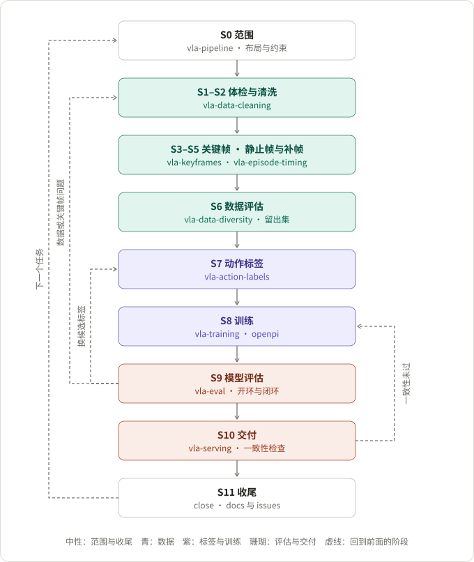
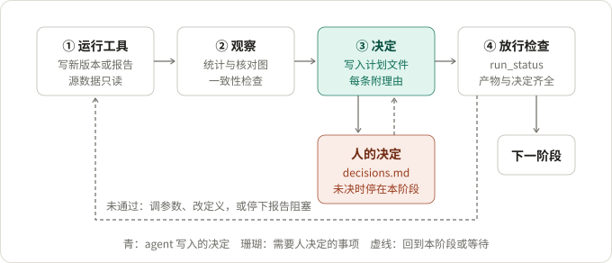

# VLA_AGENT

An agent harness for preparing robot demonstration data for VLA (vision-language-action) policies: recorded
LeRobot datasets → audit and cleaning → keyframes → still frames and end padding → coverage and held-out
split → action labels → a training-ready dataset with a data report, handed to openpi π0/π0.5 training.

面向 VLA 策略的示教数据预处理 agent harness。它把录制的 LeRobot 数据集处理成训练就绪的数据集，并写出一份数据报告，说明每个版本怎么来、每个决定的理由。

重心在数据阶段。索引约定错一帧、把真实的快速动作当成噪声删掉、关键帧定义与末端执行器不符、录制在任务完成时就截断、留出集与训练集来自同一批次——这些问题在训练日志里看不出来，只能在数据阶段发现。训练、评估、交付是下游，只读取预处理交付的数据集。

仓库由三部分组成：

- **数据预处理 skill 与工具**：总流程 `vla-pipeline` 和五个阶段 skill（`.claude/skills/vla-*`）；工具包 `vla_tools`，包括各阶段工具，以及运行状态检查 `run_status` 和数据报告 `data_report`；
- **工作约定与通用 skill**：由 [explicit-agent](https://github.com/luo-jingw/AgentTemplate) 初始化，包括 `AGENTS.md` 和 `plan` / `work` / `experiment` / `close` 等；
- **下游**：一个 `vla-downstream` skill，以及 openpi 接入（`integrations/openpi/` 中的补丁，`vla_openpi` 中的 transform、数据配置与启动函数）。

## 数据预处理流程

| 阶段 | skill | 做什么 | 产物 |
|---|---|---|---|
| S0 范围 | `vla-pipeline` | 机器人布局、任务与末端执行器、模型 H 与运控约束 | `robot_spec.json`、`run.json` |
| S1–S2 体检与清洗 | `vla-data-cleaning` | 确认索引约定；找出静止维、时间戳缺口、指令毛刺、相机冻结、重复 episode、关节跳变；按书面决定修复或排除 | `audit.json`、清洗版 |
| S3、S5 关键帧 | `vla-keyframes` | 按任务与末端执行器定义关键帧；检测、一致性检查、逐类看图核对、记录修正 | `keyframes.json`、核对图 |
| S4 静止帧与补帧 | `vla-episode-timing` | 静止帧保留或裁掉；末尾补帧，让策略学会完成后保持 | 定时版 |
| S6 数据评估 | `vla-data-diversity` | 覆盖、聚类、近重复、离群；覆盖各簇的留出集 | `diversity.json` |
| S7 动作标签 | `vla-action-labels` | 按服务端执行的目标与录制路径的几何差异做网格搜索，用闭环标签回放和倍数上限（关节速度上限、推理延迟下）选执行长度和执行倍速，构建训练版与评估版 | 标签数据集、`arc_resample.json` |
| — | `data_report` | S0–S7 都通过后写出数据报告 | `data_report.md` |
| S8 下游 | `vla-downstream` | 训练、留出集评估、服务端交付 | 见下文 |
| S9 收尾 | `close` | 已验证的结论写入 `docs/`，未解决的问题写入 `issues.md` | — |

动作标签给每一帧单独取点：它的 H 个输出点取自当前状态之后 span 个录制帧的窗口，落在录制路径上；部署时服务端以当前位姿和这 H 个点为节点，用三次样条重建出逐帧目标。点可以按时间等间隔取（`time`），也可以按几何曲率取：`curvature` 以关节路径几何曲率的立方根乘以路径长度作为进度（曲率的弦长对整个数据集固定），转弯处密、直线处稀，点的位置由路径形状决定，不随示教速度变化；窗口内没有关键帧时，第 H 个点恰好落在窗口末端。服务端按均匀时间放这些节点，整体快慢由部署时的执行倍速 r 决定：r = 1 时每个窗口按录制的节奏走完，r > 1 沿同一条插值路径走得更快，标签和训练不变（LIBERO 上倍速 2 的闭环标签回放用 0.61 倍录制帧完成）。服务端也可以按速度定时：同一条样条按关节速度上限分配时间，倍速只作上限，夹爪切换处固定停留实测的动作时间（DROID 上 90% 的集可行时，加夹爪停留的加速比 4.58 倍，统一倍速 1.96 倍）。静态任务里沿路径的快慢不影响结果，所以网格搜索和标签回放比较的是执行目标走过的路径与指令切换的位置，而不是逐帧时间。

每个阶段的产物只有一个写入者。凡是需要判断的处理都要写明决定和理由，缺少时工具拒绝写出；需要人做的决定写进 `decisions.md`，未决时流程停在该阶段。细节见 `.claude/skills/vla-pipeline/SKILL.md`。

## 循环

外层循环沿数据阶段向下推进，每个阶段过了放行条件才进入下一阶段。数据评估发现批次或离群问题时，回到清洗阶段排除；下游发现的数据问题（关键帧不对、需要排除 episode、覆盖不足）也回到产生它的数据阶段，下游不修改数据。

<picture>
  <source media="(prefers-color-scheme: dark)" srcset="docs/figures/pipeline-loop-dark.svg">
  
</picture>

图 1　外层循环：数据阶段占流程的主体，下游只是其中一个框。

内层循环在每个数据阶段内部进行：运行工具得到新版本或报告，观察统计和核对图，把判断写成带理由的决定，再用 `run_status` 做放行检查。需要人做的决定写进 `decisions.md`，阶段停在 `waiting`，等人决定、agent 把决定写回对应文件后再继续；检查没有通过时，调参数、改定义后重跑，或者停下报告阻塞。

<picture>
  <source media="(prefers-color-scheme: dark)" srcset="docs/figures/stage-loop-dark.svg">
  
</picture>

图 2　内层循环：决定文件是需要判断的产物，也是审查 agent 行为的入口。

两张图由 `docs/figures/make_figures.py` 生成，浅色和深色各一份，几何相同。修改脚本后重新运行即可。

## 运行状态与数据报告

一次运行的状态就是它的产物，外加两份记录：`runs/<task>/run.json` 登记各数据集版本的路径，`runs/<task>/decisions.md` 列出需要人做的决定。`run_status` 只读这些文件，逐阶段给出 `passed`、`open`、`missing` 或 `waiting`，并说明检查了哪个产物、为什么没有通过。下面是合成数据上的一次运行，停在等人决定的地方：

```text
$ python -m vla_tools.run_status runs/synthetic_pick
stage name                       status   artifact                     reason
S0    scope                      passed   run.json, robot_spec.json    4 action dims: joints [0, 1, 2], commands [3]
S1    audit                      passed   audit.json                   action[t] = state[t+1] (0.0e+00 vs 5.3e-01); findings: command_pulse, jump_continuing, jump_discontinuity, jump_isolated
S2    clean                      waiting  decisions.md                 D-001 pending: discontinuity jump at 7:42: keep or repair
S3    keyframes pass 1           missing  keyframes_pass1.json         no first keyframe pass
...
next: S2 clean (waiting)
```

能用文件检查的放行条件都由 `run_status` 检查，包括数据集版本谱系、索引约定、跳变是否都有书面决定、关键帧开放问题、每类关键帧的核对图、留出集是否覆盖各簇、候选里有没有逐帧基线、训练版去掉的是否正是留出集。核对图看得对不对、簇的解释是否合理，仍由 agent 和人判断。

S0–S7 都通过后，`data_report` 写出 `runs/<task>/data_report.md`：数据集版本与谱系、体检发现与清洗决定、关键帧定义与修正、静止帧与补帧的决定及理由、覆盖与留出集、标签候选与配置、标签回放，以及人的决定。

## 使用

**环境**：Python 3.11。`pip install -e .` 安装数据预处理工具，依赖见 `pyproject.toml`。

**两种方式**：
1. 以本仓库为项目根：数据放在 `data/`，每个任务的计划与报告放在 `runs/<task>/`，从 `vla-pipeline` skill 开始；
2. 在已用 explicit-agent 初始化的项目中，拷贝 `.claude/skills/vla-*` 与 `CLAUDE.md`，并安装本包。

**命令链**（在项目根目录运行）：

```bash
pip install -e .
python -m vla_tools.run_index       runs/<task> --task <task> --spec runs/<task>/robot_spec.json --source data/<src>
python -m vla_tools.audit           --dataset data/<src> --spec runs/<task>/robot_spec.json --out runs/<task>/audit.json --review-dir runs/<task>/audit_review
python -m vla_tools.clean           --dataset data/<src> --spec runs/<task>/robot_spec.json --plan runs/<task>/cleaning_plan.json --out data/<src>-clean
python -m vla_tools.run_index       runs/<task> --clean data/<src>-clean
python -m vla_tools.keyframe_detect --dataset data/<src>-clean --spec runs/<task>/robot_spec.json --keyframes-spec runs/<task>/keyframes_spec.json --out runs/<task>/keyframes_pass1.json
python -m vla_tools.episode_timing  --dataset data/<src>-clean --spec runs/<task>/robot_spec.json --keyframes runs/<task>/keyframes_pass1.json --plan runs/<task>/timing_plan.json --out data/<src>-timed
python -m vla_tools.run_index       runs/<task> --timed data/<src>-timed
python -m vla_tools.keyframe_detect --dataset data/<src>-timed --spec runs/<task>/robot_spec.json --keyframes-spec runs/<task>/keyframes_spec.json --out runs/<task>/keyframes.json
python -m vla_tools.keyframe_review --dataset data/<src>-timed --spec runs/<task>/robot_spec.json --keyframes runs/<task>/keyframes.json --type <type> --camera <col> --out runs/<task>/kf_review
python -m vla_tools.diversity       --dataset data/<src>-timed --spec runs/<task>/robot_spec.json --keyframes runs/<task>/keyframes.json --holdout 4 --out runs/<task>/diversity.json
python -m vla_tools.sweep           --dataset data/<src>-timed --spec runs/<task>/robot_spec.json --keyframes runs/<task>/keyframes.json --horizon 10 --spans 10 20 30 --out runs/<task>/sweep.json
python -m vla_tools.label_replay    --dataset data/<src>-timed --spec runs/<task>/robot_spec.json --keyframes runs/<task>/keyframes.json --config runs/<task>/label_config.json --out runs/<task>/replay_<labels>.json
python -m vla_tools.rate_ceiling    --dataset data/<src>-timed --spec runs/<task>/robot_spec.json --keyframes runs/<task>/keyframes.json --horizon 10 --per-frame --spans 20 30 --event-density 0 2 --latency <s> --out runs/<task>/rate_ceiling.json
python -m vla_tools.rate_ceiling    ... --velocity-fraction 1 --switch-hold <close s> <open s> --out runs/<task>/rate_ceiling_velocity.json
python -m vla_tools.build_labels    --dataset data/<src>-timed --spec runs/<task>/robot_spec.json --keyframes runs/<task>/keyframes.json --config runs/<task>/label_config.json --exclude <holdout> --out data/<src>-<labels>-train
python -m vla_tools.build_labels    --dataset data/<src>-timed --spec runs/<task>/robot_spec.json --keyframes runs/<task>/keyframes.json --config runs/<task>/label_config.json --out data/<src>-<labels>-eval
python -m vla_tools.run_index       runs/<task> --labels <labels> data/<src>-<labels>-train data/<src>-<labels>-eval
python -m vla_tools.data_report     runs/<task>
```

每一步之后都可以运行 `python -m vla_tools.run_status runs/<task>`。`tests/pipeline_chain.py` 用同样的命令在合成数据上跑通整条链。

## 测试

```bash
pip install -e ".[test]"
pytest
```

测试用合成的 LeRobot 数据集（含已知关键帧和人为注入的录制故障）检查各数据工具、整条 S0–S7 链路、`run_status` 对每一类放行条件的判断，以及 LoRA 合并。不需要 GPU 和网络。在 openpi 环境中运行时，还会检查 openpi 相关部分。每项已验证行为对应哪个测试，见 `docs/validation.md`。

真实数据上的观测来自三份数据：一份双臂 UR3 数据；一个 LIBERO 仿真抓放任务（50 条 Franka Panda 示教，S0–S7 全部通过，含网格搜索与闭环标签回放的结果）；DROID 的 60 条遥操抓放（Franka Panda），与 LIBERO 一起测关节速度上限和推理延迟下的倍数上限。LIBERO 任务还在仿真器里闭环执行：标签本身开环执行，以及两个只在标签上不同的 pi0.5 策略（`curvature` s64 与逐帧 `time`，冻结 VLM，10k 步），各 16 组条件、每组 50 次。逐帧策略按速度定时加夹爪停留，成功 42/50，用时为倍速 1 的 0.44（倍速 1 为 31/50）；`curvature` 策略在上限 8 时成功 29/50，速度是逐帧倍速 1 的 5.05 倍，但在每组对应设置下都低于逐帧策略。见 `docs/validation.md`。

## 下游

训练、评估、交付合并在一个 `vla-downstream` skill 里，只读取训练版、评估版和其中的 `arc_resample.json`。接入 openpi 的步骤见 `integrations/openpi/README.md`，双臂 UR3 的完整配置见 `examples/ur3_dual_arm/`，LIBERO 关节空间的训练与服务配置见 `examples/libero_object/`。`src/vla_libero/` 在 LIBERO 仿真器里用关节位置控制执行标签（开环）和服务端返回的点（闭环，推理延迟按仿真帧模拟），需要单独的仿真环境（mujoco 3.2.3、robosuite 1.4.1、LIBERO）。这部分需要 openpi 环境，并打上 `integrations/openpi/patches/` 中的补丁。

## 目录

```text
AGENTS.md, CLAUDE.md, PROJECT.md, plan.md, issues.md, opportunities.md   explicit-agent 约定与状态文件
.claude/skills/vla-pipeline/, vla-data-*/, vla-keyframes/, ...           数据预处理 skill
.claude/skills/vla-downstream/                                           下游 skill
.claude/skills/{plan,work,parallelize,experiment,close,...}              通用 skill（模板）
src/vla_tools/                                                           工具包（python -m vla_tools.<module>）
src/vla_openpi/, integrations/openpi/                                    openpi 接入
src/vla_libero/                                                          LIBERO 仿真器里的开环回放与闭环评测
examples/ur3_dual_arm/, examples/libero_object/                          双臂 UR3、LIBERO 的配置示例
tests/                                                                   合成数据测试
docs/validation.md, docs/figures/                                        已验证的行为；README 中的图及生成脚本
```

## 约定

本仓库按 `AGENTS.md`（explicit-agent 0.1.0，`964b9d9`）管理：模板自带的文件不手改，项目内容写入 `PROJECT.md`、`docs/`、`issues.md`、`opportunities.md`；VLA skill 是项目自有 skill。
